  

  
  &nbsp;&nbsp;
  
  &nbsp;&nbsp;
  

 

  <strong>Data Analyst and Information Systems graduate transforming raw data into actionable insights.</strong> 
  I work across data cleaning, exploratory analysis, visualization, business intelligence, machine learning, and NLP.

  ⚽ Building with discipline, teamwork, and a data-first mindset.

  
  
  
  

 

<h2 align="center">🔵🔴 Starting XI — Tech Stack</h2>

  
<strong>Data Science, Machine Learning &amp; NLP</strong>

  
    
  Pandas · NumPy · Scikit-learn · TF-IDF · Naïve Bayes · Random Forest

  
<strong>Visualization &amp; Business Intelligence</strong>

  
  
  
  
  

  
<strong>Databases, Backend &amp; Web</strong>

  

 

<h2 align="center">🚀 Featured Projects &amp; Experience</h2>

### 🏆 SIDINI: Outbreak Early Warning Dashboard

**1st Place, Digital Health Innovation**

Designed data logic, simulated surveillance PRNG datasets, and implemented LLM analysis with the Groq API for health office early warnings.

### 📜 Sentiment Analysis of Super App Polri

**Undergraduate Thesis**

Built an end-to-end NLP and machine learning pipeline on 3,000 reviews using Python, TF-IDF, Naïve Bayes, and Random Forest—achieving **92.58% accuracy**.

### 📊 EDA on Social Media Usage

**VINIX Seven Aurum**

Performed exploratory data analysis on 117 respondents using Pandas, Matplotlib, and Seaborn to extract behavioral insights.

 

<h2 align="center">🟡 Contribution Matchday</h2>

Every contribution is another pass forward. Pac-Man keeps the attack moving across the grid.

<picture>
  <source media="(prefers-color-scheme: dark)" srcset="https://raw.githubusercontent.com/Suryanulloh/Suryanulloh/pacman-output/pacman-contribution-graph-dark.svg">
  <source media="(prefers-color-scheme: light)" srcset="https://raw.githubusercontent.com/Suryanulloh/Suryanulloh/pacman-output/pacman-contribution-graph.svg">
  
</picture>

 

<h2 align="center">🎧 Matchday Playlist</h2>

  

 

<em>Think as a team. Build with purpose. Let the data lead the play.</em>

